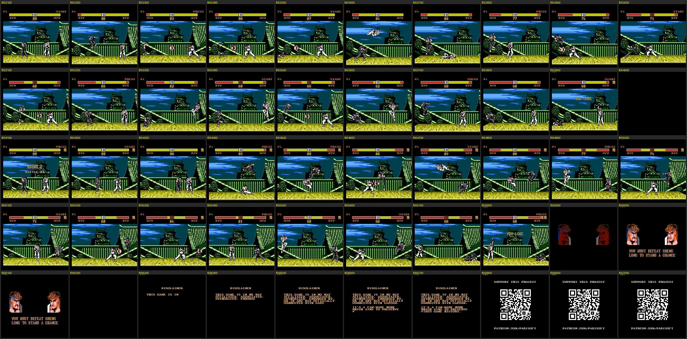
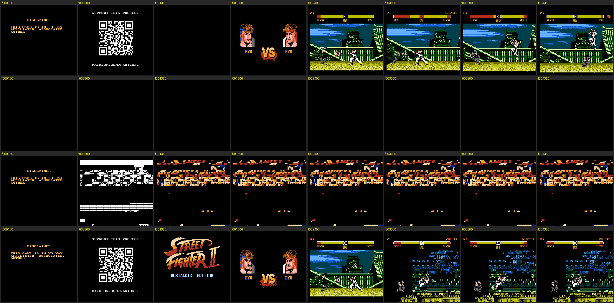

# ROM Architecture — Street Fighter II NE (DEMO, Parisoft)

Everything here was taken from the ROM itself: disassembled code reading + instrumented execution on the emulator (Mesen 2, headless). Where something is a hypothesis, it is marked **(hypothesis)**.

Address convention: `BB:AAAA` = PRG bank `BB` (8 KB), CPU address `AAAA`.

---------------------------------------------------------------------------------------------------

## 1. Cartridge

| Item | Value |
|------|-------|
| File | 1,048,592 bytes, NES 2.0 header |
| Mapper | 5 (MMC5) |
| PRG-ROM | 512 KB = 64 banks of 8 KB (`$00`–`$3F`) |
| CHR-ROM | 512 KB = 256 pages of 2 KB |
| SHA-1 | `0bf9dc578de5a10bb9f429845c26fd2f958a9aed` |

Actual usage: **22% of PRG** (36 of 64 banks are empty) and **58 of 256 CHR pages**. Plenty of free space.

One full match, one screenshot every 100 frames (fight, defeat, quote, back to warning):



### MMC5 configuration (done in `Main`, `3F:F7A2`)

| Register | Value | Meaning |
|----------|-------|---------|
| `$5100` | 3 | PRG in 4 windows of 8 KB (`$8000`, `$A000`, `$C000`, `$E000`) |
| `$5101` | 2 | CHR in 2 KB pages |
| `$5104` | 3 | ExRAM as read-only RAM |
| `$5105` | `$44` | nametables: vertical mirroring |
| `$5114`–`$5117` | bank \| `$80` | PRG bank of each window (bit 7 = ROM) |
| `$5121`/`$5123`/`$5125` | page | CHR of sprites (fighter 1, fighter 2, extras) — 8x16 sprites |
| `$5129`/`$512B` | page | CHR of background |
| `$5203`/`$5204` | line / enable | IRQ by scanline count |

### Where each bank is mapped

The author wired each bank to a fixed window: **bank `n` always appears in window `n mod 4`** (base `$8000 + (n & 3) * $2000`). Verified in trace: no bank ever appeared in another window.

| Window | Content | Banks used |
|--------|---------|------------|
| `$8000` (`$5114`) | character data: frames/metasprites (+ AI) | `$00` Ryu, `$04` Ken (Ken playable frames/collisions), `$08` `$0C` `$10` `$1C` `$24` (portraits only), `$20` (HUD/effects + portrait), `$3C` (fiches, names, quotes, selection, VS) |
| `$A000` (`$5115`) | fighter states; music | `$01` (Ryu states), `$05` (Ken states, hand-written source), `$29` and `$2D` (music, FamiTone2 format) |
| `$C000` (`$5116`) | DPCM voices; compressed screens | `$02 $06 $0A $0E $12 $16 $1A $1E $22 $26 $2A` (DPCM), `$36` (RLE nametables) |
| `$E000` (`$5117`) | **code** | `$37`, `$3B`, `$3F` |

---------------------------------------------------------------------------------------------------

## 2. Code: three banks + repeated kernel

| Bank | Role | Free |
|------|------|------|
| `$3F` | reset, main loop, **fight engine core** (states, AI, commands, physics) | 819 bytes |
| `$3B` | the fight itself (rounds, HUD, drawing, split screen), VS screens and final quote, video utilities | ~120 bytes (full!) |
| `$37` | sound (FamiTone2 + voices), warning, title and selection screens | ~1.5 KB |
| `$00` | at end of Ryu data bank: his AI (`RyuAiThink`, `00:8F46`) | — |

### Kernel (`$FC7C`–`$FF9A`, identical in the three banks)

Since vectors are at `$FFFA`–`$FFFF`, every bank that can be at `$E000` needs interrupt handlers. The author repeated the same block in all three. In the source it exists **only once** (`src/kernel.inc`), included by the three banks.

* `IrqHandler` (`$FC7C`): raster effects with MMC5 scanline counter. In the fight: separates HUD from background and makes the floor parallax **line by line** (`Irq_FloorLine`). In menus: swaps background CHR by screen band. **It is cycle-counted code** (`dex/bne` loops, `nop`). Do not touch without measuring.
* `NmiHandler` (`$FE1E`): sends OAM, runs screen mode task (`NmiDispatch`, 8-entry table indexed by `ScreenMode`), fixes sprite CHR, scrolling and PPU registers, increments `FrameCounter` and sets `VBlankFlag` (the main loop waits on this flag).
* `PaletteUpload` (`$FED8`): sends the 24 bytes of `PaletteBuf` to the PPU when `PaletteDirty` ≠ 0.

The **RESET code exists only in bank `$3F`** — this is the cause of the soft reset crash (see `docs/BUGS.md`).

### Inter-bank calls (`farcall`)

A 20-byte trampoline is copied to RAM at `$049E` (`InstallFarCall`). In the source calls appear as macros (`src/macros.inc`):

```
farcall Routine      ; 18 bytes: pushes return and current bank, A = target bank, X:Y = target-1, jmp FarCall
farjmp  Routine      ; 12 bytes: "tail call" variant (no own return)
```

The original ROM has **52 `farcall` and 7 `farjmp`**. The current generated source shows **51 `farcall`** because the
temporary Ken patch at `3F:F828` replaces the `ScreenDisclaimer` `farcall` with 18 NOPs. Static method: 48 bank call
sites + 3 `kernel.inc` copies = 51; adding back the patched call gives 52. The target bank comes from the label itself
(ca65 `.bank()`).

### Table dispatch ("RTS trick")

Pattern `lda TabHi,x / pha / lda TabLo,x / pha / rts` (table holds address−1). There are 8 dispatchers; the generator detects the pattern and emits symbolic tables (`.byte <(Routine-1)`).

| Dispatcher | Table | Use |
|------------|-------|-----|
| `NmiDispatch` (`K:FE66`) | 8 | NMI task per screen mode |
| `StateCondDispatch` (`3F:E168`) | 12 | state machine conditions |
| `AiOpDispatch` (`3F:E82D`) | 18 | AI script opcodes |
| `CmdStepDispatch` (`3F:EA6A`) | 19 | command recognizer steps |
| `AiCallCharRoutine` (`3F:E7A4`) | 1 | native AI per character (Ryu only) |
| `3F:E4C5`, `3F:F0A8`, `00:8FE0` | 6, 6, 1 | still unnamed |

An unofficial opcode is used on purpose: `$CB` (`AXS #imm`). `txa / axs #$FC` adds 4 to X (advances OAM index).

---------------------------------------------------------------------------------------------------

## 3. Game flow

`MainLoop` (`3F:F828`) is literally the sequence of screens:

```
MainLoop:
    farcall ScreenDisclaimer      ; 37:F2CB   mode 0   warning + "support this project" screen (ScreenSupport)
    farcall ScreenTitle           ; 37:F4E5   mode 1
    ...                           ;           FighterChar = $FF,$FF ; P1 human, P2 CPU
    farcall ScreenPlayerSelect    ; 37:EF4C   mode 2
    farcall ScreenVersus          ; 3B:EA61   mode 3
    farcall Match                 ; 3B:F551   modes 4 (round intro), 5 (fight), 6 (end of round)
    farcall ScreenWinQuote        ; 3B:EC1B   mode 7
    jmp MainLoop
```

`ScreenMode` (`$B0`) is 0–7 per the table above and chooses the NMI task. The demo is this: one match (best of 3, with draws and extra round) and back to warning.

### The fight (`Match` → `RoundStart` → `FightFrame`)

`FightFrame` (`3B:F58E`) runs once per frame:

1. waits for `VBlankFlag`; clears `OamIndex`;
2. `SoundUpdate` (bank `$37`);
3. `RoundLogic`: intro (`RoundIntroStep`, voices "ROUND n … FIGHT"), clock (`RoundTimerTick`: −1 every 32 frames, digits in `TimerTens`/`TimerOnes`), end (`RoundEndStep`: "YOU WIN/LOSE", "PERFECT");
4. `StageSplitSetup`: sets up split-screen IRQ; `HitStop` freezes logic every other frame;
5. `FightersUpdate` (bank `$3F`): updates both fighters, alternating order each frame, and calls `DrawFighters`;
6. `StageParallaxCalc`, `OamHideRest`.

`RoundResult` (`$B9`): `$FF` in progress, 0 = P1 won, 1 = P2 won, 2 = draw. On time out, whoever has more `FighterHP − FighterDmgPending` wins. Full energy = `$58` (88).

---------------------------------------------------------------------------------------------------

## 4. The fight engine is data-driven

This is the most important point for those who want to **finish the game**: almost nothing of Ryu is "in the code".

### 4.1 Character fiche — bank `$3C`

`FighterLoadChar` (`3B:E000`) reads 23 tables with **10 positions each** (one column per character), indexed by `FighterChar`. The planned roster is written in the ROM itself (`CharNameTbl`, `3C:84CE`, and victory quotes in `WinQuoteLine1/2`):

| id | Name | Frame bank (`CharFrameBankTbl`) | What exists in ROM |
|----|------|---------------------------------|--------------------|
| 0 | RYU | `$00` | **complete**: frames, states (`$01`), AI, voices, portrait |
| 1 | KEN | `$04` | 4.3 KB of frames (same structure as Ryu, other tiles) + portrait; partial states in hand-written bank `$05`. Ken is paused (`docs/ROADMAP.md` Step 3); moveset incomplete. |
| 2 | CHUN LI | `$08` | portrait only |
| 3 | GUILE | `$0C` | portrait only |
| 4 | BLANKA | `$10` | portrait only |
| 5 | EHONDA | — | nothing |
| 6 | BALROG | — | nothing |
| 7 | SAGAT | `$1C` | portrait only |
| 8 | M.BISON | `$20` | portrait only (bank `$20` also holds HUD sprites) |
| 9 | ZANGIEF | `$24` | portrait only |

All ten have name, victory quote and country voice (`CountryVoiceTbl`, `37:E0EF`) already recorded.

| Table | Content | Values today |
|-------|---------|--------------|
| `$80D2` `CharFrameBankTbl` | frame bank (window `$8000`) | `00 04 08 0C 10 00 00 1C 20 24` |
| `$80C8` `CharStateBankTbl` | state bank (window `$A000`) | `01 05 01 01 01 01 01 01 00 01` (Ryu and Ken real) |
| `$80DC` | third bank (use to confirm) | `00 04 00 00 00 00 00 00 20 00` |
| `$8000`–`$80BE` | 10 pairs of pointers (lo/hi) for basic states and character tables | **columns 0 (Ryu) and 1 (Ken)** |

Ryu's column pointers: eight pointer tables at the start of the state bank, plus `3F:E0C0` (list of character special moves: indices in `CmdMotionTbl`, terminated by `$FF`) and `00:8E72` (AI script table). `FighterLoadChar` copies each one to RAM (`ram_031E`–`ram_033A`):

| Table in state bank | Copied to | Role (who uses) |
|---------------------|-----------|-----------------|
| `$A000` | `ram_031E` | states by **direction** (InputDir: neutral, forward, back) — `InputDispatch` |
| `$A012` | `ram_0322` | states by **button** (weak/strong punch/kick) — `InputDispatch` |
| `$A01A` | `ram_0326` | states of **special moves** (recognizer index) — `InputDispatch` |
| `$A026` | `ram_032A` | **guards** (reaction to received hit, index `zp_16&$3F`) — `GuardRedirect` and damage routine |
| `$A03E` | `ram_032E` | **standing** damage reaction — damage routine |
| `$A056` | `ram_0336` | **crouching** damage reaction — damage routine |
| `$A06E` | `ram_0332` | **neutral** damage reaction — damage routine |
| `$A086` | `ram_033A` | **throws** (damage `$0C`) — damage routine |

### 4.2 State machine — bank `$01` (Ryu)

The state bank starts with pointer tables (`$A000`–`$A0AF`) and then is a sequence of two record types. **The entire bank was read with this grammar without leftovers**: 71 states and 274 frames. Each field is described in detail in `docs/FORMATS.md`.

**State header — 7 bytes**

| Offset | Content |
|--------|---------|
| +0 | condition number leading to this state (`0`–`$0B`, see below; `≥ $80`/`$FF` = unconditional) |
| +1, +2 | pointer to next alternative to test (linked list of transitions) |
| +3, +4 | pointer to next state when this one ends (`StateAdvance`) |
| +5 | state byte → `FighterState` (class; low 3 bits are posture: bit 0 standing, bit 1 crouching). `StateSetByte` also triggers class sound: `$70`–`$98` SFX, `$A0`–`$E0` fighter voice |
| +6 | hit count → `AttackHitsLeft` (`zp_28`): how many attack boxes the state can still land |

The first animation frame of the state comes right after the header (header + 7). The winning node of a transition is applied whole: becomes current state (alternative list lives in neighboring headers, chained by +1/+2).

**Animation frame — 14 bytes (16 if looped)**

| Offset | Content |
|--------|---------|
| +0 | duration in video frames (1–100) |
| +1, +2 | pointer to metasprite (frame bank) |
| +3, +4 | pointer to collision boxes (collision bank, `zp_1C`) — read only when the **high byte is nonzero**; `0` = no boxes |
| +5 | effect parameter → `EffectParam` (damage `&$1F` when frame hits; projectile speed) |
| +6 | effect type → `EffectType`: `$0B` fires projectile, `$20` sound effect, `$8x`/`$Cx` opponent hit reaction class |
| +7 | flags → `FrameFlags` (bit 0 special move, bit 1 button move, bit 2 direction, bit 3 force immediate transition, bit 4 re-face, bit 5 edge-clamp exempt, bit 6 shove overflow to opponent) |
| +8 | movement mode: 0/1 absolute speed, 2/3 acceleration, 4/5 subpixel (vel/16) |
| +9, +10 | `VelX` / `VelY` (signed; interpreted per mode +8) |
| +11 | loop repeats → `LoopRepeat` (`zp_44`) |
| +12, +13 | pointer to next frame (0 = end of state) |
| +14, +15 | **only if +11 ≠ 0**: loop target pointer (where to repeat while loop not zero) |

The collision record behind +3/+4 is **variable-length**: three boxes (body 1, body 2, attack), each 4 bytes when its height byte is nonzero and 1 byte when absent. Details in `docs/FORMATS.md` §10 and `docs/FORMATS_OPEN.md` §1.

**The 12 conditions** (dispatched by `StateCondDispatch`, `3F:E168`; table at `3F:E171` holds address−1): `CondOpponentAttacks` (0), `CondOpponentFarBack` (1), `CondOpponentNear` (2), `CondStanding` (3), `CondCrouching` (4), `CondInAir` (5), `CondOnGroundOrVelX` (6), `CondInputDown` (7), `CondProjectileFree` (8), `CondCanGrab` (9), `CondVictory` ($0A), `CondRoundLost` ($0B). Exact semantics of each are in `annotations/sf2ne.ann` comments and `docs/FORMATS.md`.

`StateCheckTransitions` (`3F:E0CE`) walks the alternative list (+1) testing condition (+0) of each; first true becomes `FighterNextPtr`. In generated source each record is separate, with condition, class and hit count summarized in header, and frame fields decoded:

```
; -- STATE (header, 7 bytes)   [cond=$0A CondVictory | class=$E9 | hits=0]
D01_A0B0:
    .byte $0A
    .word D01_A10B
    .word D01_A12E
    .byte $E9,$00

; -- frame (14 bytes)   [dur=8 fx=$00/$00 fl=$10 mov=$04 vx=0 vy=0 rep=0]   [1st frame of the state above: header+7]
    .byte $08
    .word D00_8D81
    ...
```

The directives `statebank 01 frames=00 from=A0B0 to=B1C6` and `statecond 3F:E171 n=12` (in `annotations/sf2ne.ann`) are what link this structural reading — the second makes the generator print condition name in header. A new character gets its own with another identical line.

### 4.3 Frames and drawing — bank `$00` (Ryu)

`DrawFighter` (`3B:EDD9`) maps `FighterFrameBank` and calls `DrawMetasprite` (`3B:F2EA`), which builds 8x16 sprites in OAM. Metasprite format: attribute byte; then groups `quantity, dx, dy, tiles…`; ends with negative byte. Each fighter has its own CHR page (`FighterChrPage`, sent to `$5121`/`$5123` in NMI).

### 4.4 Human control

`FighterUpdate` decides by `FighterIsCpu`: human → `InputUpdate` (`3F:E98D`); CPU → `AiUpdate`. `InputUpdate` does:

1. `JoyPollSafe` — reads controller;
2. `InputDirection` — d-pad → `InputDir` (already relative to side fighter faces);
3. `InputButtons` — A/B → `InputAttack` (0 weak punch, 1 strong punch, 2 weak kick, 3 strong kick, `$FF` nothing). Strength comes from **button hold time**; origin of delay and command repetition (`docs/BUGS.md`);
4. `InputCommands` — special move recognizer: walks character's special list and advances steps of each sequence (`CmdStepDispatch`, 19 handlers). Sequences are in `CmdMotionTbl` (`3F:E067`), 4 bytes each, with controller bits (`04` down, `01` forward, `02` back, `08` up, `80` A, `40` B): `04 01` (↓→ hadouken), `04 02` (↓← tatsumaki), `01 04 01` (→↓→ shoryuken) and also sequences Ryu doesn't use — `02 01` and `04 08` (charge moves), `80 80 80` / `40 40 40` (button mash), `01 04 02 08` (spin).

### 4.5 AI

Two levels:

1. **per-character native code** (`RyuAiThink`, `00:8F46`): looks at state and opponent distance (`DistanceX`, `DistanceY`), randomizes (`Random`) and picks a script;
2. **script interpreter** (`AiUpdate`, `3F:E7D2`): bytecode with 18 opcodes (`$80`–`$91` → `AiOp00`–`AiOp11`), `$FF` ends. Ryu scripts are at `00:8E82`–`00:8F45`.

A new character needs its own "think" routine and scripts (table `AiCharRoutine` only has Ryu).

---------------------------------------------------------------------------------------------------

## 4.6 The source is relocatable (and how that was proven)

Assembling identically isn't enough to be able to change things: an address written as a number (`lda #$8C / ldx #$F9`, or `.byte $F6,$A0` inside a table) breaks the game as soon as something moves. Three mechanisms handle this:

1. **emulator origin tracing** (`tools/mesen/ptrtrace.lua`): 114 immediate pairs and 2,550 bytes of data recognized as pointers because the game actually used them as pointers;
2. **tables**: entries not visited squeezed between confirmed pointers (34 words);
3. **state bank structure** (section 4.2): 153 state pointers no trace visited.

Proof: `tools/shift_test.sh 00 01 04 20 29 2D 36 3C 37 3B 3F` inserts one byte at the start of **each** of the 11 code and data banks (everything changes address; 44,892 bytes different) and `tools/mesen/regress.sh` compares that ROM with the original in 5 matches with same inputs: screens, sound (APU writes) and game timeline **identical**. Before pointer symbolization, the same test gave black screen at boot.



*Before symbolization: line 1 = original; lines 2–4 = banks `$3F`, `$3B`, `$37` shifted by 1 byte.*

Out of guarantee: voice banks (directory keeps address/64), portrait banks, and any path no test exercised. `tools/ptr_candidates.py` lists what remains suspicious in code (10 pairs, all reviewed: they are coordinates and video addresses).

---------------------------------------------------------------------------------------------------

## 5. Sound

* Engine: **FamiTone2** (Shiru) in the author's library version (`familib/src/ft2`), with extensions (pitch slides). Routines match public source and are named the same: `FamiToneInit`, `FamiToneMusicPlay`, `FamiToneUpdate`, `FamiToneSfxPlay`, `_FT2ChannelUpdate`… Variables at `$0100`–`$018B`.
* Music: banks `$29` and `$2D` (mapped at `$A000` by `MusicBank`). `SoundLoadSong` (`37:E3E0`).
* Effects: `SfxData` (`37:E1A3`), FamiTone2 format.
* **Voices (DPCM)**: 32 samples, all at 33 kHz. Directory at `37:E000` (bank per sample) and `37:E020` (address/64, size/16, rate). A voice can have two halves in different banks: `VoicePlay` plays first and `SoundUpdate` chains second when DMC channel stops.
  `make assets` exports all to WAV with usage deduced from code (`extracted/dpcm/INDICE.txt`):
  0 "ROUND", 1–3 round number, 5 "FIGHT", 6 "YOU", 7 "WIN", 8 "LOSE", 9 "PERFECT", 10–15 country names (table `CountryVoiceTbl`: Japan, Brazil, USA, China, USSR, Thailand — per fighter country), 16–18 menu sounds, 24–31 Ryu voices.

---------------------------------------------------------------------------------------------------

## 6. Video

* Static screens: RLE-compressed nametables (NESlib format), decompressed by `PpuUnRle` (`3B:E3BE`). Title and support screens are in bank `$3B`; the rest in bank `$36`.
* `FadeIn` / `FadeOut` (`3B:E4D6` / `3B:E426`): palette fade in steps.
* Warning text: `TextDisclaimer` (`37:F391`), ASCII.
* Graphics: `make assets` generates `extracted/chr/*.png` (2 KB pages).

---------------------------------------------------------------------------------------------------

## 7. PRG bank map

| Bank | Window | Bytes used | Content |
|------|--------|------------|---------|
| `$00` | `$8000` | 5.2 KB | Ryu: metasprites, AI scripts, `RyuAiThink` (code), collision boxes |
| `$01` | `$A000` | 4.5 KB | Ryu: states / animations |
| `$04` | `$8000` | 4.3 KB | Ken: frames/metasprites/collisions + portrait; AI stub at `$90E0` |
| `$05` | `$A000` | 4.5 KB | Ken: states/animations (hand-written source in `src/bank_05.s`; original bank is all `$FF`) |
| `$08 $0C $10 $1C $24` | `$8000` | ~50 each | selection portraits |
| `$20` | `$8000` | 1.6 KB | HUD/effect sprites ("ROUND", "FIGHT", "YOU WIN"…) |
| `$29`, `$2D` | `$A000` | 5.7 / 4.9 KB | music (FamiTone2) |
| `$36` | `$C000` | 1.3 KB | RLE screens + tables |
| `$3C` | `$8000` | 1.8 KB | **character fiches**, names, victory quotes, selection/VS data |
| `$02`…`$2A` (step 4) | `$C000` | — | 11 DPCM voice banks |
| `$37`, `$3B`, `$3F` | `$E000` | 6.4 / ~7.9 / 7.3 KB | code |
| other 36 | — | 0 | empty (`$FF`) |

Occupancy values are **published estimates, not revalidated** in Phase 4. Bank `$3B` is full (~120 bytes free per §2);
the earlier `8.1 KB` figure was arithmetically impossible for an 8 KB bank and is superseded.
