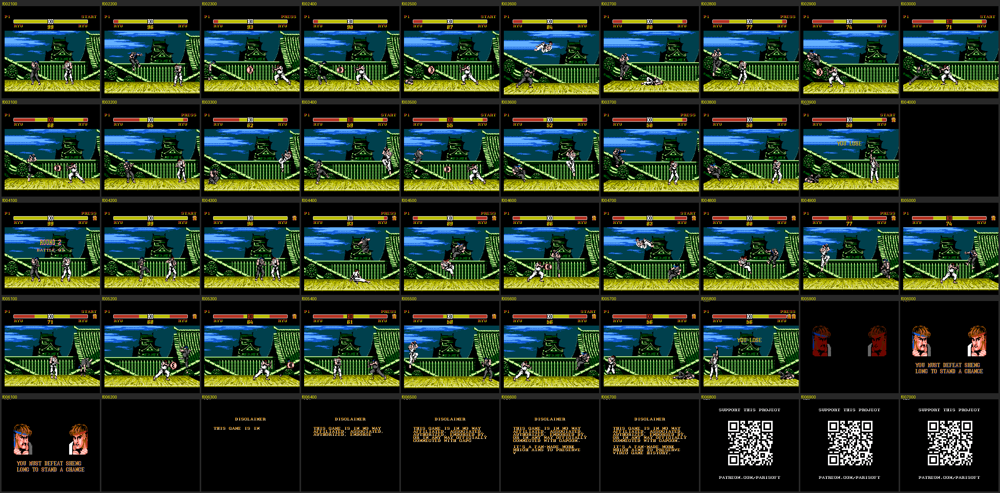
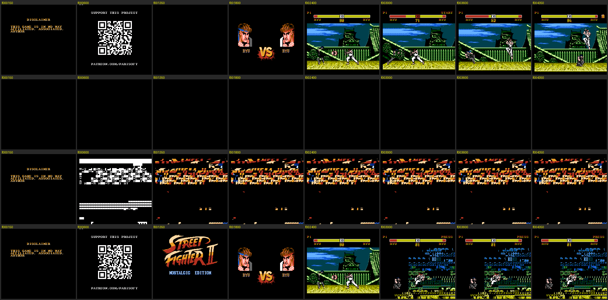

# Arquitetura do ROM — Street Fighter II NE (DEMO, Parisoft)

Tudo aqui foi tirado do próprio ROM: leitura do código desmontado + execução instrumentada no emulador
(Mesen 2, sem janela). Onde algo é hipótese, está escrito **(hipótese)**.

Convenção de endereços: `BB:AAAA` = banco de PRG `BB` (8 KB), endereço de CPU `AAAA`.

---------------------------------------------------------------------------------------------------

## 1. Cartucho

| Item | Valor |
|---|---|
| Arquivo | 1.048.592 bytes, cabeçalho NES 2.0 |
| Mapper | 5 (MMC5) |
| PRG-ROM | 512 KB = 64 bancos de 8 KB (`$00`–`$3F`) |
| CHR-ROM | 512 KB = 256 páginas de 2 KB |
| SHA-1 | `0bf9dc578de5a10bb9f429845c26fd2f958a9aed` |

Uso real: **22% do PRG** (36 dos 64 bancos estão vazios) e **58 das 256 páginas de CHR**. Há muito espaço livre.

Uma partida inteira, um screenshot a cada 100 quadros (luta, derrota, frase, volta ao aviso):



### Configuração do MMC5 (feita em `Main`, `3F:F7A2`)

| Registrador | Valor | Significado |
|---|---|---|
| `$5100` | 3 | PRG em 4 janelas de 8 KB (`$8000`, `$A000`, `$C000`, `$E000`) |
| `$5101` | 2 | CHR em páginas de 2 KB |
| `$5104` | 3 | ExRAM como RAM somente-leitura |
| `$5105` | `$44` | nametables: espelhamento vertical |
| `$5114`–`$5117` | banco \| `$80` | banco de PRG de cada janela (bit 7 = ROM) |
| `$5121`/`$5123`/`$5125` | página | CHR dos sprites (lutador 1, lutador 2, extras) — sprites 8x16 |
| `$5129`/`$512B` | página | CHR do fundo |
| `$5203`/`$5204` | linha / liga | IRQ por contagem de scanlines |

### Onde cada banco é mapeado

O autor ligou cada banco numa janela fixa: **o banco `n` sempre aparece na janela `n mod 4`**
(base `$8000 + (n & 3) * $2000`). Verificado no trace: nenhum banco apareceu em outra janela.

| Janela | Conteúdo | Bancos usados |
|---|---|---|
| `$8000` (`$5114`) | dados de personagem: frames/metasprites (+ IA) | `$00` Ryu, `$04` Ken (não usado), `$08` `$0C` `$10` `$1C` `$24` (só retratos), `$20` (HUD/efeitos + retrato), `$3C` (fichas, nomes, frases, seleção, VS) |
| `$A000` (`$5115`) | estados do lutador; música | `$01` (estados do Ryu), `$29` e `$2D` (músicas, formato FamiTone2) |
| `$C000` (`$5116`) | vozes DPCM; telas comprimidas | `$02 $06 $0A $0E $12 $16 $1A $1E $22 $26 $2A` (DPCM), `$36` (nametables RLE) |
| `$E000` (`$5117`) | **código** | `$37`, `$3B`, `$3F` |

---------------------------------------------------------------------------------------------------

## 2. Código: três bancos + kernel repetido

| Banco | Papel | Livre |
|---|---|---|
| `$3F` | reset, laço principal, **núcleo do motor de luta** (estados, IA, comandos, física) | 819 bytes |
| `$3B` | a luta em si (rounds, HUD, desenho, divisão de tela), telas VS e frase final, utilitários de vídeo | ~120 bytes (cheio!) |
| `$37` | som (FamiTone2 + vozes), telas de aviso, título e seleção | ~1,5 KB |
| `$00` | no fim do banco de dados do Ryu: a IA dele (`RyuAiThink`, `00:8F46`) | — |

### Kernel (`$FC7C`–`$FF9A`, idêntico nos três bancos)

Como os vetores ficam em `$FFFA`–`$FFFF`, todo banco que pode estar em `$E000` precisa ter os tratadores de
interrupção. O autor repetiu o mesmo bloco nos três. No fonte ele existe **uma vez só** (`src/kernel.inc`),
incluído pelos três bancos.

* `IrqHandler` (`$FC7C`): efeitos de raster com o contador de scanlines do MMC5. Na luta: separa o HUD do cenário
  e faz o chão em paralaxe **linha a linha** (`Irq_FloorLine`). Nos menus: troca o CHR do fundo por faixa da tela.
  **É código contado em ciclos** (laços `dex/bne`, `nop`). Não mexer sem medir.
* `NmiHandler` (`$FE1E`): envia a OAM, roda a tarefa do modo de tela (`NmiDispatch`, tabela de 8 entradas
  indexada por `ScreenMode`), acerta CHR dos sprites, rolagem e registradores do PPU, incrementa `FrameCounter`
  e liga `VBlankFlag` (é por essa flag que o laço principal espera).
* `PaletteUpload` (`$FED8`): manda os 24 bytes de `PaletteBuf` para o PPU quando `PaletteDirty` ≠ 0.

O código de **RESET só existe no banco `$3F`** — é a causa do travamento no soft reset (ver `docs/BUGS.md`).

### Chamadas entre bancos (`farcall`)

Um trampolim de 20 bytes é copiado para a RAM em `$049E` (`InstallFarCall`). No fonte as chamadas aparecem como
macros (`src/macros.inc`):

```
farcall Rotina      ; 18 bytes: empilha retorno e banco atual, A = banco alvo, X:Y = alvo-1, jmp FarCall
farjmp  Rotina      ; 12 bytes: variante "tail call" (sem retorno próprio)
```

São 52 `farcall` e 7 `farjmp` no ROM. O banco alvo sai sozinho do rótulo (`.bank()` do ca65).

### Despacho por tabela ("RTS trick")

Padrão `lda TabHi,x / pha / lda TabLo,x / pha / rts` (a tabela guarda endereço−1). Há 8 despachantes;
o gerador detecta o padrão e emite as tabelas simbólicas (`.byte <(Rotina-1)`).

| Despachante | Tabela | Uso |
|---|---|---|
| `NmiDispatch` (`K:FE66`) | 8 | tarefa do NMI por modo de tela |
| `StateCondDispatch` (`3F:E168`) | 12 | condições da máquina de estados |
| `AiOpDispatch` (`3F:E82D`) | 18 | opcodes dos roteiros de IA |
| `CmdStepDispatch` (`3F:EA6A`) | 19 | passos do reconhecedor de comandos |
| `AiCallCharRoutine` (`3F:E7A4`) | 1 | IA nativa por personagem (só Ryu) |
| `3F:E4C5`, `3F:F0A8`, `00:8FE0` | 6, 6, 1 | ainda sem nome |

Um opcode não oficial é usado de propósito: `$CB` (`AXS #imm`). `txa / axs #$FC` soma 4 a X (avança o índice da OAM).

---------------------------------------------------------------------------------------------------

## 3. Fluxo do jogo

`MainLoop` (`3F:F828`) é literalmente a sequência de telas:

```
MainLoop:
    farcall ScreenDisclaimer      ; 37:F2CB   modo 0   aviso + tela "support this project" (ScreenSupport)
    farcall ScreenTitle           ; 37:F4E5   modo 1
    ...                           ;           FighterChar = $FF,$FF ; P1 humano, P2 CPU
    farcall ScreenPlayerSelect    ; 37:EF4C   modo 2
    farcall ScreenVersus          ; 3B:EA61   modo 3
    farcall Match                 ; 3B:F551   modos 4 (intro do round), 5 (luta), 6 (fim do round)
    farcall ScreenWinQuote        ; 3B:EC1B   modo 7
    jmp MainLoop
```

`ScreenMode` (`$B0`) vale 0–7 conforme a tabela acima e escolhe a tarefa do NMI.
O demo é isso: uma partida (melhor de 3, com empates e round extra) e volta ao aviso.

### A luta (`Match` → `RoundStart` → `FightFrame`)

`FightFrame` (`3B:F58E`) roda uma vez por quadro:

1. espera `VBlankFlag`; zera `OamIndex`;
2. `SoundUpdate` (banco `$37`);
3. `RoundLogic`: intro (`RoundIntroStep`, vozes "ROUND n … FIGHT"), relógio (`RoundTimerTick`: −1 a cada 32 quadros,
   dígitos em `TimerTens`/`TimerOnes`), fim (`RoundEndStep`: "YOU WIN/LOSE", "PERFECT");
4. `StageSplitSetup`: arma o IRQ da divisão de tela; `HitStop` congela a lógica quadro sim/quadro não;
5. `FightersUpdate` (banco `$3F`): atualiza os dois lutadores, alternando a ordem a cada quadro, e chama `DrawFighters`;
6. `StageParallaxCalc`, `OamHideRest`.

`RoundResult` (`$B9`): `$FF` em andamento, 0 = P1 venceu, 1 = P2 venceu, 2 = empate. No tempo esgotado ganha quem tem
mais `FighterHP − FighterDmgPending`. Energia cheia = `$58` (88).

---------------------------------------------------------------------------------------------------

## 4. O motor de luta é dirigido por dados

Este é o ponto mais importante para quem quer **terminar o jogo**: quase nada do Ryu está "no código".

### 4.1 Ficha do personagem — banco `$3C`

`FighterLoadChar` (`3B:E000`) lê 23 tabelas com **10 posições cada** (uma coluna por personagem), indexadas por
`FighterChar`. O elenco planejado está escrito no próprio ROM (`CharNameTbl`, `3C:84CE`, e as frases de vitória em
`WinQuoteLine1/2`):

| id | Nome | Banco de frames (`CharFrameBankTbl`) | O que existe no ROM |
|---|---|---|---|
| 0 | RYU | `$00` | **completo**: frames, estados (`$01`), IA, vozes, retrato |
| 1 | KEN | `$04` | 4,3 KB de frames (mesma estrutura do Ryu, outros tiles) **nunca usados**, retrato; sem estados |
| 2 | CHUN LI | `$08` | só retrato |
| 3 | GUILE | `$0C` | só retrato |
| 4 | BLANKA | `$10` | só retrato |
| 5 | EHONDA | — | nada |
| 6 | BALROG | — | nada |
| 7 | SAGAT | `$1C` | só retrato |
| 8 | M.BISON | `$20` | só retrato (o banco `$20` também guarda os sprites do HUD) |
| 9 | ZANGIEF | `$24` | só retrato |

Todos os dez têm nome, frase de vitória e voz de país (`CountryVoiceTbl`, `37:E0EF`) já gravados.

| Tabela | Conteúdo | Valores hoje |
|---|---|---|
| `$80D2` `CharFrameBankTbl` | banco dos frames (janela `$8000`) | `00 04 08 0C 10 00 00 1C 20 24` |
| `$80C8` `CharStateBankTbl` | banco dos estados (janela `$A000`) | `01 00 01 01 01 01 01 01 00 01` (só o do Ryu é real) |
| `$80DC` | terceiro banco (uso a confirmar) | `00 04 00 00 00 00 00 00 20 00` |
| `$8000`–`$80BE` | 10 pares de ponteiros (lo/hi) para os estados básicos e tabelas do personagem | **só a coluna 0 (Ryu)** |

Os ponteiros da coluna do Ryu: `$A000`, `$A012`, `$A01A`, `$A026`, `$A03E`, `$A056`, `$A06E`, `$A086` (oito tabelas
de ponteiros no início do banco de estados — falta identificar o papel de cada uma), `3F:E0C0` (lista dos golpes
especiais do personagem: índices em `CmdMotionTbl`, terminada por `$FF`) e `00:8E72` (tabela de roteiros de IA).

### 4.2 Máquina de estados — banco `$01` (Ryu)

O banco de estados começa com tabelas de ponteiros (`$A000`–`$A0AF`) e depois é uma sequência de dois tipos de
registro. **O banco inteiro foi lido com esta gramática sem sobrar nada**: 71 estados e 274 quadros.

**Cabeçalho de estado — 7 bytes**

| Desl. | Conteúdo |
|---|---|
| +0 | número da condição que leva a este estado (`0`–`$0B` → `StateCond00`–`StateCond0B`; `$FF` = nenhuma) |
| +1, +2 | ponteiro para a próxima alternativa a testar (lista encadeada de transições) |
| +3, +4 | ponteiro para o estado seguinte quando este termina (`StateAdvance`) |
| +5 | byte de estado → `FighterState` (5 bits altos = classe, 3 baixos = flags). `StateSetByte` também dispara o som da classe: `$70`–`$98` efeito sonoro, `$A0`–`$E0` voz do lutador |
| +6 | parâmetro (0, 1, 2 ou 6), guardado em `$28,x` — significado a confirmar |

O primeiro quadro de animação do estado vem logo depois do cabeçalho (cabeçalho + 7).

**Quadro de animação — 14 bytes (16 se houver desvio)**

| Desl. | Conteúdo |
|---|---|
| +0 | duração em quadros de vídeo (1–100) |
| +1, +2 | ponteiro para o metasprite (banco de frames) |
| +3, +4 | ponteiro para as caixas de colisão (banco de frames), ou 0 |
| +5 … +10 | seis bytes ainda não decifrados (movimento / flags do golpe) |
| +11 | condição de desvio: 0 = nenhuma; 3, 5 ou 7 nos 21 quadros que desviam |
| +12, +13 | ponteiro para o próximo quadro (0 = fim) |
| +14, +15 | **só se +11 ≠ 0**: ponteiro do desvio (usado, por exemplo, para repetir um trecho da animação) |

`StateCheckTransitions` (`3F:E0CE`) percorre a lista de alternativas (+1) testando a condição (+0) de cada uma;
a primeira verdadeira vira `FighterNextPtr`. No fonte gerado cada registro sai separado e comentado:

```
; -- ESTADO (cabecalho, 7 bytes)
D01_A0B0:
    .byte $0A
    .word D01_A10B
    .word D01_A12E
    .byte $E9,$00

; -- quadro (14 bytes)   [1o quadro do estado acima: cabecalho+7]
    .byte $08
    .word D00_8D81
    ...
```

A diretiva `statebank 01 frames=00 from=A0B0 to=B1C6` (em `annotations/sf2ne.ann`) é o que liga essa leitura
estrutural. Um personagem novo ganha a sua com outra linha igual.

### 4.3 Frames e desenho — banco `$00` (Ryu)

`DrawFighter` (`3B:EDD9`) mapeia `FighterFrameBank` e chama `DrawMetasprite` (`3B:F2EA`), que monta sprites 8x16 na
OAM. Formato do metasprite: byte de atributo; depois grupos `quantidade, dx, dy, tiles…`; termina com byte negativo.
Cada lutador tem a sua página de CHR (`FighterChrPage`, enviada a `$5121`/`$5123` no NMI).

### 4.4 Controle humano

`FighterUpdate` decide por `FighterIsCpu`: humano → `InputUpdate` (`3F:E98D`); CPU → `AiUpdate`. `InputUpdate` faz:

1. `JoyPollSafe` — lê o controle;
2. `InputDirection` — direcional → `InputDir` (já relativo ao lado para onde o lutador olha);
3. `InputButtons` — A/B → `InputAttack` (0 soco fraco, 1 soco forte, 2 chute fraco, 3 chute forte, `$FF` nada).
   A força vem do **tempo com o botão apertado**; é a origem do atraso e da repetição de comandos (`docs/BUGS.md`);
4. `InputCommands` — reconhecedor de golpes especiais: percorre a lista de especiais do personagem e avança os
   passos de cada sequência (`CmdStepDispatch`, 19 tratadores). As sequências ficam em `CmdMotionTbl` (`3F:E067`),
   4 bytes cada, com os bits do controle (`04` baixo, `01` frente, `02` trás, `08` cima, `80` A, `40` B):
   `04 01` (↓→ hadouken), `04 02` (↓← tatsumaki), `01 04 01` (→↓→ shoryuken) e também sequências que o Ryu não usa —
   `02 01` e `04 08` (golpes de carga), `80 80 80` / `40 40 40` (botão repetido), `01 04 02 08` (giro).

### 4.5 IA

Dois níveis:

1. **código nativo por personagem** (`RyuAiThink`, `00:8F46`): olha estado e distância do oponente (`DistanceX`,
   `DistanceY`), sorteia (`Random`) e escolhe um roteiro;
2. **interpretador de roteiros** (`AiUpdate`, `3F:E7D2`): bytecode com 18 opcodes (`$80`–`$91` → `AiOp00`–`AiOp11`),
   `$FF` termina. Os roteiros do Ryu ficam em `00:8E82`–`00:8F45`.

Um personagem novo precisa da sua rotina "pensar" e dos seus roteiros (a tabela `AiCharRoutine` só tem o Ryu).

---------------------------------------------------------------------------------------------------

## 4.6 O fonte é realocável (e como isso foi provado)

Montar idêntico não basta para poder mexer: um endereço escrito como número (`lda #$8C / ldx #$F9`, ou
`.byte $F6,$A0` dentro de uma tabela) quebra o jogo assim que algo muda de lugar. Três mecanismos cuidam disso:

1. **rastreamento de origem no emulador** (`tools/mesen/ptrtrace.lua`): 114 pares de imediatos e 2.550 bytes de dados
   reconhecidos como ponteiros porque o jogo de fato os usou como ponteiros;
2. **tabelas**: entradas não visitadas espremidas entre ponteiros confirmados (34 palavras);
3. **estrutura do banco de estados** (seção 4.2): 153 ponteiros de estados que nenhum trace visitou.

Prova: `tools/shift_test.sh 00 01 04 20 29 2D 36 3C 37 3B 3F` insere um byte no começo de **cada um** dos 11 bancos
de código e dados (tudo muda de endereço; 44.892 bytes diferentes) e `tools/mesen/regress.sh` compara esse ROM com
o original em 5 partidas com as mesmas entradas: telas, som (escritas na APU) e linha do tempo do jogo **idênticos**.
Antes da simbolização dos ponteiros, o mesmo teste dava tela preta já no boot.



*Antes da simbolização: linha 1 = original; linhas 2–4 = bancos `$3F`, `$3B`, `$37` deslocados em 1 byte.*

Fora da garantia: os bancos de vozes (o diretório guarda endereço/64), os bancos-retrato, e qualquer caminho que
nenhum teste exercitou. `tools/ptr_candidates.py` lista o que sobrou de suspeito no código (10 pares, todos
revisados: são coordenadas e endereços de vídeo).

---------------------------------------------------------------------------------------------------

## 5. Som

* Motor: **FamiTone2** (Shiru) na versão da biblioteca do próprio autor (`familib/src/ft2`), com extensões
  (slides de afinação). As rotinas batem com o fonte público e estão nomeadas igual: `FamiToneInit`,
  `FamiToneMusicPlay`, `FamiToneUpdate`, `FamiToneSfxPlay`, `_FT2ChannelUpdate`… Variáveis em `$0100`–`$018B`.
* Músicas: bancos `$29` e `$2D` (mapeados em `$A000` por `MusicBank`). `SoundLoadSong` (`37:E3E0`).
* Efeitos: `SfxData` (`37:E1A3`), formato FamiTone2.
* **Vozes (DPCM)**: 32 amostras, todas a 33 kHz. Diretório em `37:E000` (banco de cada amostra) e `37:E020`
  (endereço/64, tamanho/16, taxa). Uma voz pode ter duas metades em bancos diferentes: `VoicePlay` toca a primeira
  e `SoundUpdate` encadeia a segunda quando o canal DMC para.
  `make assets` exporta todas para WAV com o uso deduzido do código (`extracted/dpcm/INDICE.txt`):
  0 "ROUND", 1–3 número do round, 5 "FIGHT", 6 "YOU", 7 "WIN", 8 "LOSE", 9 "PERFECT", 10–15 nomes de países
  (tabela `CountryVoiceTbl`: Japão, Brasil, EUA, China, URSS, Tailândia — conforme o país de cada lutador),
  16–18 sons de menu, 24–31 vozes do Ryu.

---------------------------------------------------------------------------------------------------

## 6. Vídeo

* Telas estáticas: nametables comprimidas em RLE (formato do NESlib), descompactadas por `PpuUnRle` (`3B:E3BE`).
  As do título e da tela de apoio ficam no banco `$3B`; as demais no banco `$36`.
* `FadeIn` / `FadeOut` (`3B:E4D6` / `3B:E426`): fade de paleta em passos.
* Texto do aviso: `TextDisclaimer` (`37:F391`), ASCII.
* Gráficos: `make assets` gera `extracted/chr/*.png` (páginas de 2 KB).

---------------------------------------------------------------------------------------------------

## 7. Mapa de bancos de PRG

| Banco | Janela | Bytes usados | Conteúdo |
|---|---|---|---|
| `$00` | `$8000` | 5,2 KB | Ryu: metasprites, roteiros de IA, `RyuAiThink` (código), caixas de colisão |
| `$01` | `$A000` | 4,5 KB | Ryu: estados / animações |
| `$04` | `$8000` | 4,3 KB | Ken: frames (nunca usados no demo) + retrato |
| `$08 $0C $10 $1C $24` | `$8000` | ~50 cada | retratos da seleção |
| `$20` | `$8000` | 1,6 KB | sprites de HUD/efeitos ("ROUND", "FIGHT", "YOU WIN"…) |
| `$29`, `$2D` | `$A000` | 5,7 / 4,9 KB | músicas (FamiTone2) |
| `$36` | `$C000` | 1,3 KB | telas RLE + tabelas |
| `$3C` | `$8000` | 1,8 KB | **fichas dos personagens**, nomes, frases de vitória, dados de seleção / VS |
| `$02`…`$2A` (passo 4) | `$C000` | — | 11 bancos de vozes DPCM |
| `$37`, `$3B`, `$3F` | `$E000` | 6,4 / 8,1 / 7,3 KB | código |
| os outros 36 | — | 0 | vazios (`$FF`) |
