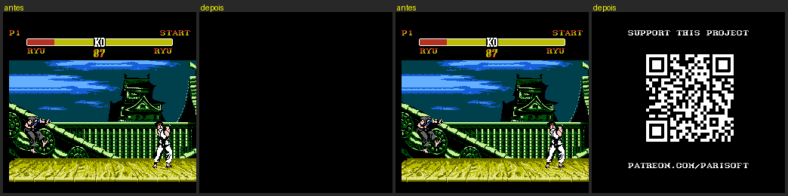
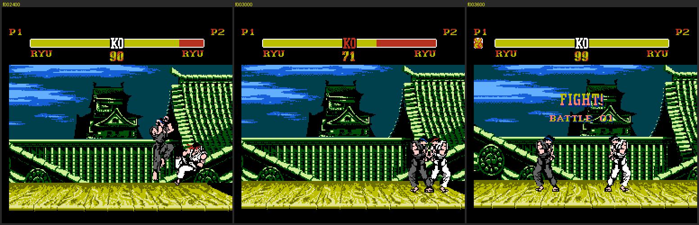

# Bugs relatados — o que já se sabe

Os relatos vêm dos comentários da página do demo. Para cada um: causa (quando encontrada), onde está no código,
como foi testado e o que falta.

| Relato | Situação |
|---|---|
| Trava no soft reset | **causa encontrada, corrigido e testado** (`make fixed`) |
| Comandos atrasados / repetidos; hadouken difícil | **causa encontrada e medida**; um ajuste experimental pronto, correção de jogabilidade em aberto |
| IA difícil demais | parâmetro de dificuldade localizado; efeito medido é pequeno — em aberto |
| Problema na seleção de personagem no RetroArch (fceumm) | não investigado (depende do emulador; provável diferença na emulação do MMC5) |
| (achado) modo de 2 jogadores existe e funciona, mas não é acessível | **ligado por um bloco opcional** (`MODE_VERSUS`) |

---------------------------------------------------------------------------------------------------

## 1. Travamento no soft reset — corrigido

**Causa.** O código de RESET (`Reset`, `$FF9F`) só existe no banco `$3F`. O MMC5 não é reiniciado pelo botão RESET
do console: ele mantém o banco que estava mapeado em `$E000`. Os três bancos de código têm o mesmo vetor
(`$FF9F`), mas nos bancos `$37` e `$3B` esse endereço está cheio de `$FF`. Se o reset acontece com um deles
mapeado — quase sempre —, a CPU executa lixo e para.

**Teste** (`tools/mesen/reset_test.sh <rom> <quadro> <saída>`):

```
ROM original, reset no quadro 2500 (luta, banco $3B em $E000):  PC=$006E, FrameCounter parado  -> TRAVOU
ROM original, reset no quadro  800 (aviso, banco $37 em $E000): PC=$0066, FrameCounter parado  -> TRAVOU
ROM corrigido, mesmos dois casos:                               o jogo reinicia normalmente
```



**Correção** (bloco `alt FIX_SOFT_RESET` em `annotations/sf2ne.ann`; 42 bytes no total). Em `$FC6D` — 15 bytes
livres logo antes do kernel, **nos três bancos** — entra o mesmo trecho:

```
ResetStub:
    lda #$00
    sta MMC5_IRQ_STATUS     ; o IRQ de scanline pode ter ficado armado
    lda #$BF
    sta MMC5_PRG_E000       ; banco $3F em $E000 — a próxima instrução já é lida dele (mesmos bytes, mesmo endereço)
    jmp $FF9F               ; Reset original
```

e o vetor de RESET dos três bancos passa a apontar para `ResetStub`. O código de reset original não foi tocado,
então ligar o console continua exatamente igual.

---------------------------------------------------------------------------------------------------

## 2. Comandos atrasados e repetidos — causa encontrada

Tudo está em `InputButtons` (`3F:E99A`). O jogo tem dois botões e quatro golpes (soco/chute, fraco/forte), então a
força é decidida pelo **tempo que o botão fica apertado**, com um contador por botão (`BtnAHold`, `BtnBHold`):

| O que o jogador faz | O que o código emite em `InputAttack` |
|---|---|
| aperta e solta antes de 7 quadros | golpe **fraco**, mas só **no quadro em que solta** |
| segura 7 quadros ou mais | golpe **forte** a **cada quadro**, do 7º ao 20º, e mais uma vez ao soltar |
| segura mais de 20 quadros | nada mais |

Medido no emulador (botão A, lutador parado):

```
toque de 3 quadros:   apertou em 2401, InputAttack = $FF enquanto segura; em 2404 (soltou) InputAttack = 0 e o golpe começa
segurar 30 quadros:   apertou em 2502; InputAttack = 1 em TODOS os quadros de 2514 a 2531
```

Consequências diretas, que batem com os relatos:

* **atraso**: nenhum golpe sai no quadro em que o botão é apertado — o fraco espera soltar, o forte espera 7 quadros.
  Em alguns estados a lógica roda quadro sim, quadro não (`HitStop`), e os 7 viram 14;
* **repetição**: o forte é reemitido por até 14 quadros seguidos; se a animação termina dentro dessa janela, sai de novo;
* **hadouken difícil**: o golpe especial precisa do movimento (↓→) **e** do evento do botão — o
  reconhecedor (§13 do `docs/FORMATOS.md`) exige `InputAttack == CmdKeyAttackTbl[chave]` na fase do
  botão, que dura 12 quadros após o último passo; o movimento em si também exige direção **nova** a
  cada passo, com janela de 12 quadros entre passos. Como o evento do botão só nasce ao soltar (ou
  depois de 7 quadros segurando), ele costuma chegar tarde demais para a janela que sobrou.

**Ajuste experimental pronto** (`FIX_HEAVY_ONCE`, 4 bytes): o forte passa a ser emitido uma vez só, quando o contador
chega a 7, e soltar depois disso não emite nada.

```
make fixed FIXDEFS="-D FIX_SOFT_RESET -D FIX_HEAVY_ONCE"
```

Resolve a repetição; **não** resolve o atraso. Para o atraso há uma decisão de projeto a tomar, por exemplo:

1. especiais disparam na **borda de subida** do botão (`JoyState & ~JoyPrev`), sem esperar soltar — a força do
   especial pode vir do botão (A/B) em vez do tempo;
2. baixar o limiar de 7 para 3–4 quadros (constantes `#$07` em `3F:E9AB`, `E9C2`, `E9DC`, `E9F3`);
3. golpe fraco na borda de subida e "promoção" para forte se o botão continuar apertado e a animação ainda puder ser cancelada.

A opção 1 é a que os jogos de luta de 2 botões costumam usar. O reconhecedor já está decodificado por
inteiro (§13 do `docs/FORMATOS.md`: os 5 tratadores `CmdStep*`, as tabelas e o estado intercalado), então
o caminho é mexer no `InputButtons` (origem do evento) sem tocar no caminhador do reconhecedor.

### 2.1 Opção 3 implementada: borda de subida + promoção (`FIX_EDGE_ATTACK`)

A opção 3 foi a escolhida. A seção A+B do `InputButtons` (`3F:E99A–E9FB`, 98 bytes) é reescrita por inteiro
num bloco `alt` só, e o comportamento passa a ser:

| O que o jogador faz | Com `FIX_EDGE_ATTACK` |
|---|---|
| aperta (1º quadro) | golpe **fraco** no mesmo quadro — borda de subida |
| segura do 2º ao 6º quadro | nada (zona morta) |
| segura a partir do 7º quadro | **forte** (promoção): o motor decide se o estado do lutador aceita |
| solta antes de 7 quadros | nada — o fraco já saiu no aperto |
| solta entre 7 e 20 quadros | forte uma última vez, como no original |
| solta depois de 20 quadros | nada |

```
make fixed FIXDEFS="-D FIX_SOFT_RESET -D FIX_EDGE_ATTACK"
```

177 bytes diferentes do original (42 do `FIX_SOFT_RESET` + 135 do ajuste).

O heart do ajuste é o **marcador seletivo**: o `InputDispatch` (`3F:F6C9`) gravava `$15` nos *dois* contadores a
cada despacho de botão, inclusive o fraco — o que mataria a promoção (o contador do próprio botão deixaria de
contar). O `jsr EdgeMarkHold` substitui essa gravação cega: forte despachado → `$FF` nos dois contadores (no
caminho segurado o `iny` dá wrap e desarma; na soltura o `cpy #$15` ignora), fraco despachado → `$01` só no
contador do próprio botão (segue contando, promoção aos 7). A rotina fica no espaço livre do banco (`$F949`).

Diferenças conscientes em relação ao original, ambas registradas no `annotations/sf2ne.ann`:

* segurando além de 20 quadros o forte **continua armado** (o original desistia);
* depois de ~256 quadros segurando o contador dá wrap e o botão volta a disparar fraco (o original também tinha
  um wrap ali, no `beq` de `$FF→0`).

O `FIX_HEAVY_ONCE` continua existindo como opção independente (funciona sozinho) e é **subsumido** quando o
`FIX_EDGE_ATTACK` está ligado — combinar os dois é inofensivo (a não-repetição passa a vir do marcador `$FF`).

Validação de jogabilidade: **pendente** (nenhuma validação manual foi feita nesta etapa).

Curiosidade útil: `CmdMotionTbl` (`3F:E067`) já tem sequências que o Ryu não usa — trás→frente e baixo→cima
(golpes de carga), A-A-A / B-B-B (golpes de botão repetido) e frente-baixo-trás-cima (giro de 360°).
O reconhecedor foi escrito pensando no elenco completo.

---------------------------------------------------------------------------------------------------

## 3. IA difícil — pista

`AiStartScript` (`3F:E6F3`) só inicia o roteiro pedido se `Random & 7 < AiLevel`. `MainLoop` fixa `AiLevel = 7`
(`3F:F84C`), o máximo: a CPU reage em 7 de cada 8 oportunidades. O ramo usado quando o sorteio falha
(`3F:E711`, "hesitar") **nunca executou** em nenhum trace.

Experimento: forçando `AiLevel` (`SF2_HOLD="B4:00:1:99999"`), um jogador que aperta botões ao acaso chegou a
ganhar um round com nível 0; com 3 e 7 perdeu todos. Existe efeito, mas é modesto: a dificuldade vem mais dos
roteiros e das decisões de `RyuAiThink` do que desse número. Um seletor de dificuldade é fácil de ligar aqui;
uma IA mais justa pede mexer nos roteiros (`00:8E82`–`00:8F45`).

---------------------------------------------------------------------------------------------------

## 4. Outras observações

* **Jogador 2 / modo versus — funciona, só não está ligado.** O HUD mostra "PRESS START" piscando no lado do P2,
  mas apertar START no controle 2 não faz nada: `MainLoop` fixa `FighterIsCpu+1 = 1` e nada mais mexe nisso.
  Forçando esse byte para 0 o jogo entra em **versus de verdade**: o HUD passa a mostrar "P2", o segundo lutador
  obedece ao controle 2, os rounds, o placar e a tela final funcionam. Testado no emulador por duas partidas.
  Há um bloco opcional para montar assim (1 byte de diferença, `3F:F868`):

  ```
  make fixed FIXDEFS="-D FIX_SOFT_RESET -D MODE_VERSUS"
  ```

  

  Falta a parte de interface: escolher 1P/2P (ou "P2 aperta START para entrar") e deixar o P2 escolher lutador.
* **Fim da partida**: ganhando ou perdendo, a tela seguinte é a mesma frase ("YOU MUST DEFEAT SHENG LONG…") e o jogo
  volta ao aviso. O banco `$3C` contém outras frases que nunca aparecem ("…WITH MY POWERS GREATER THAN YOURS…").
* **Voz vazia**: a entrada 4 do diretório de vozes é nula e chega a ser "tocada" (1 byte) em alguns caminhos.
