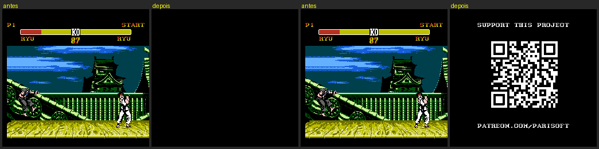

# Reported bugs — what is known

Reports come from the demo's page comments. For each one: cause (when found), where it is in the code,
how it was tested and what is missing.

| Report | Status |
|---|---|
| Freeze on soft reset | **cause found, fixed and tested** (`make fixed`) |
| Delayed / repeated commands; hard hadouken | **cause found and measured**; an experimental fix is ready, gameplay fix open |
| AI too hard | difficulty parameter located; measured effect is small — open |
| Character selection problem on RetroArch (fceumm) | not investigated (depends on the emulator; probable MMC5 emulation difference) |
| (finding) 2-player mode exists and works, but is not accessible | **enabled by an optional block** (`MODE_VERSUS`) |

---------------------------------------------------------------------------------------------------

## 1. Soft reset freeze — fixed

**Cause.** The RESET code (`Reset`, `$FF9F`) exists only in bank `$3F`. The MMC5 is not reset by the console
RESET button: it keeps the bank mapped at `$E000`. The three code banks have the same vector (`$FF9F`), but
in banks `$37` and `$3B` that address is filled with `$FF`. If the reset happens with one of them mapped —
almost always — the CPU executes garbage and stops.

**Test** (`tools/mesen/reset_test.sh <rom> <frame> <output>`):

```
Original ROM, reset at frame 2500 (fight, bank $3B at $E000):  PC=$006E, FrameCounter stopped  -> FROZE
Original ROM, reset at frame  800 (warning, bank $37 at $E000): PC=$0066, FrameCounter stopped  -> FROZE
Fixed ROM, same two cases:                                      the game restarts normally
```



**Fix** (`alt FIX_SOFT_RESET` block in `annotations/sf2ne.ann`; 42 bytes total). At `$FC6D` — 15 free bytes
right before the kernel, **in all three banks** — the same snippet goes in:

```
ResetStub:
    lda #$00
    sta MMC5_IRQ_STATUS     ; the scanline IRQ may have been left armed
    lda #$BF
```
